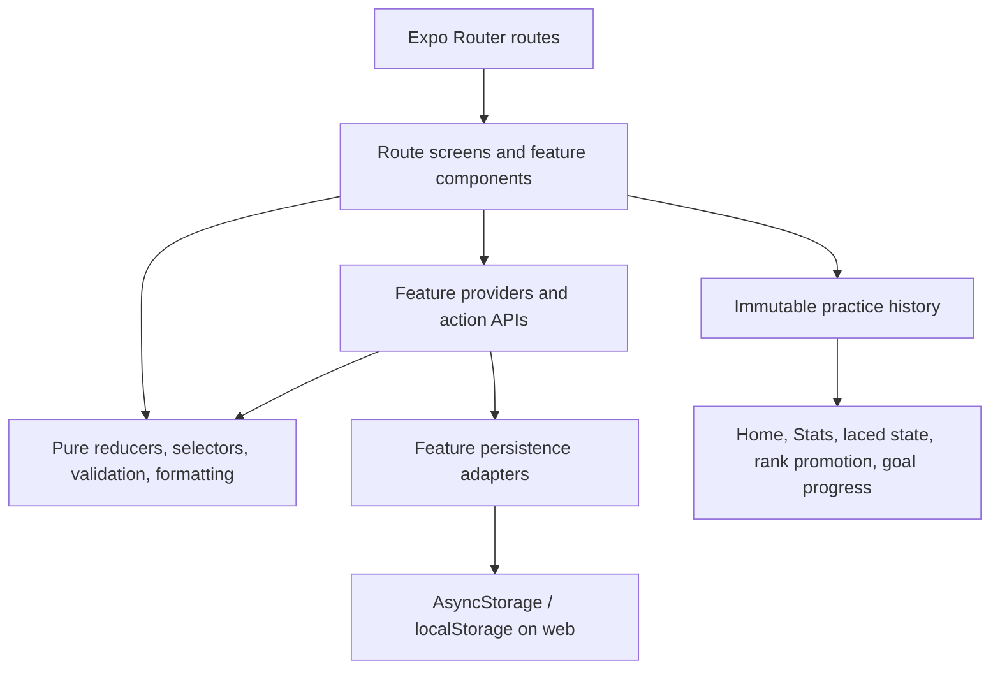
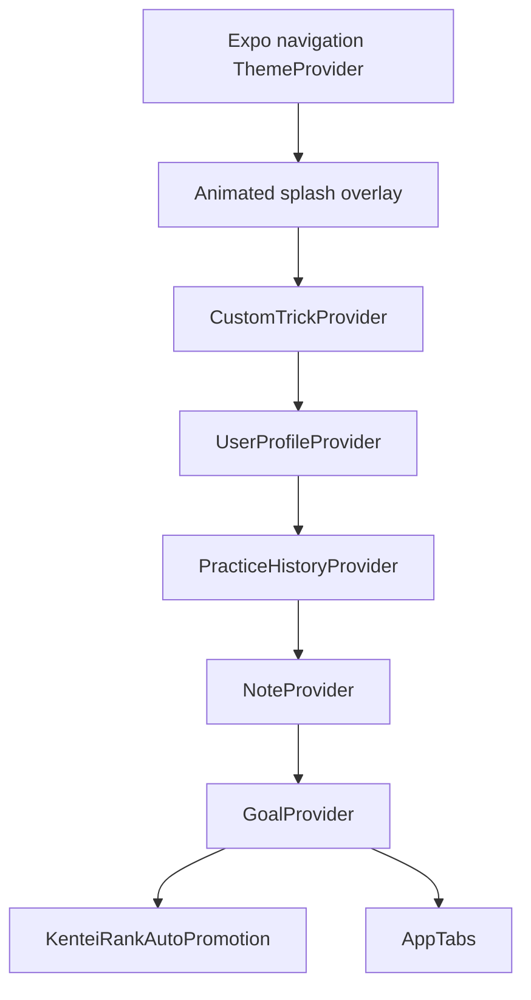
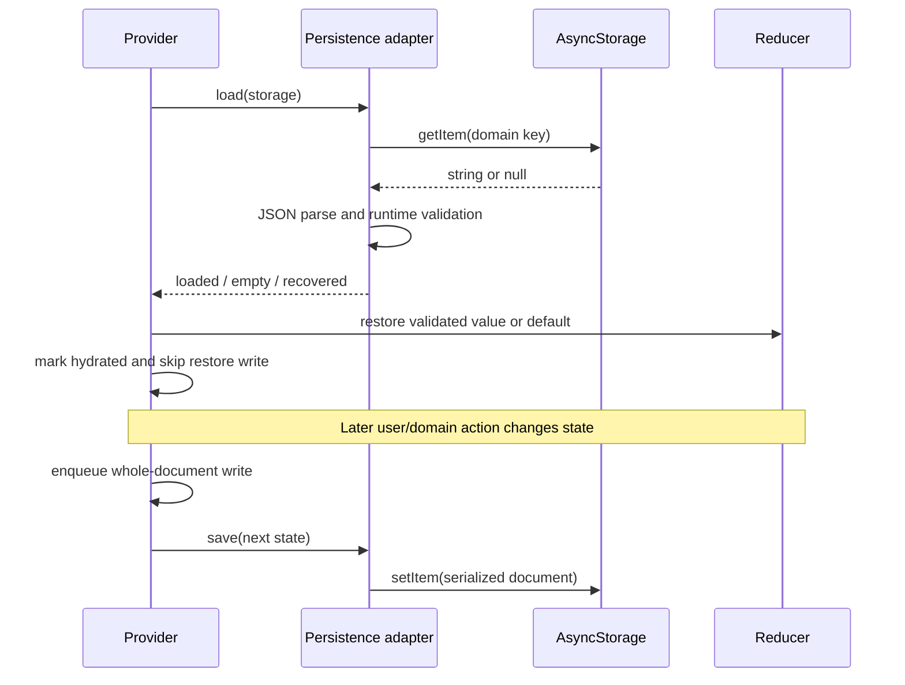
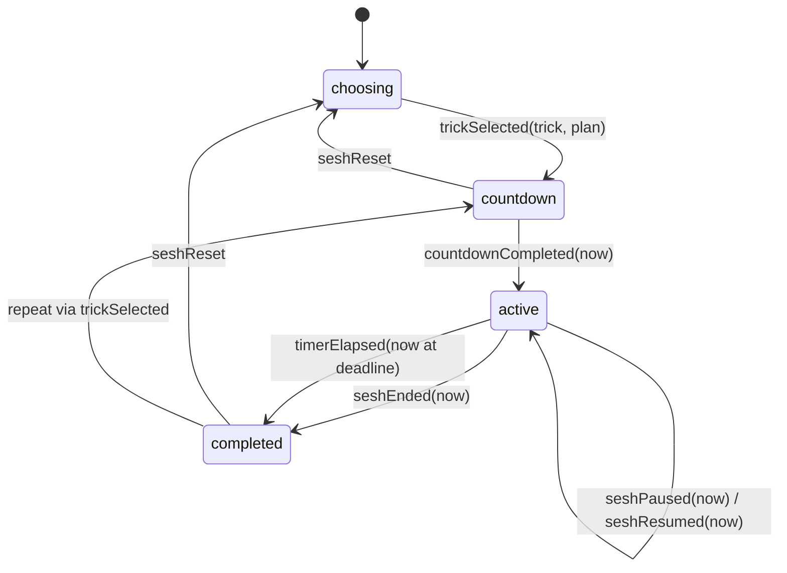
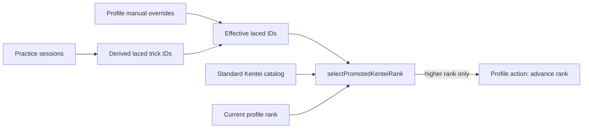
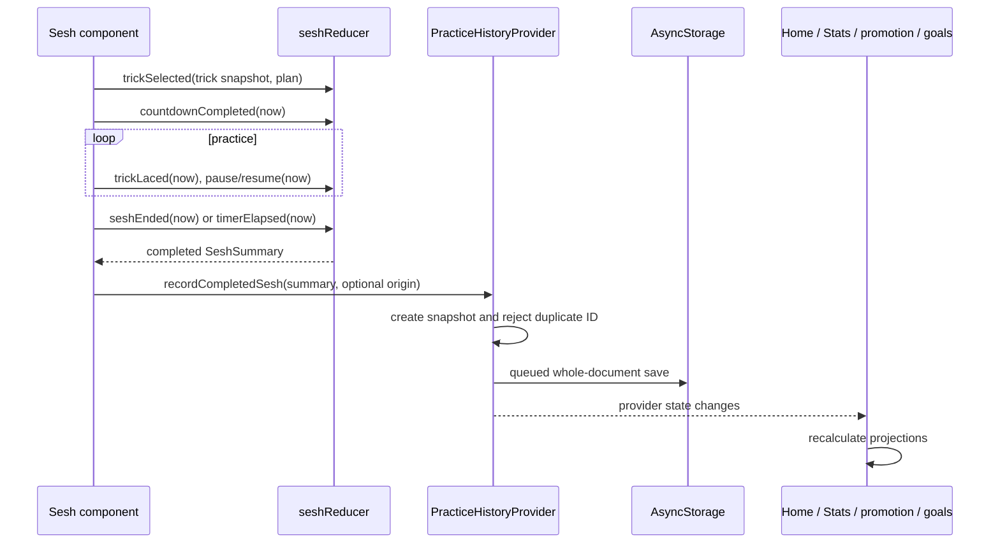

# Daily Dama architecture

> An as-built guide to the application as of August 14, 2026.
>
> This document is primarily a briefing for the repository owner: it explains what the system does, where responsibilities live, why the important boundaries exist, and which tradeoffs are intentional. It is not an instruction file that agents are expected to discover implicitly.

## Scope

This guide covers the Daily Dama product application: onboarding, Home, Sesh, Tricks, Stats, Profile, notes, goals, navigation, state, persistence, and verification.

The procedural trick-visualization experiment, its sandbox routes, and its supporting documentation are deliberately excluded. They should be evaluated as a separate subsystem if that work resumes.

This is an **as-built architecture**, not a target architecture. Where the current implementation has a limitation or the repository's older prose has drifted from the code, this guide says so explicitly.

## Executive summary

Daily Dama is a local-first Expo application with no backend, account system, or server synchronization. It is built with React 19, React Native, Expo SDK 57, Expo Router, TypeScript in strict mode, and styled-components. Web is the actively developed and verified platform; the source remains React Native-oriented for eventual iOS and Android hardening.

The application is best understood through five architectural choices:

1. **Feature-local ownership instead of one global store.** Each persistent concern owns its model, reducer, runtime validation, storage adapter, React provider, and public hooks. There is no Redux store and no general application-state singleton.
2. **Pure domain logic separated from effects.** Reducers and selectors receive timestamps and data as arguments. React components and providers own timers, `Date.now()`, wake locks, navigation, AsyncStorage, and other effects.
3. **Immutable practice history as the analytical source of truth.** A completed Sesh appends a snapshot record. Stats, streaks, personal bests, Home summaries, laced status, rank promotion, and goal progress are derived from records rather than maintained as mutable counters.
4. **Stable identities plus selective snapshots.** Domain objects use generated IDs that survive renames. Historical or independently meaningful records also store name snapshots, allowing past sessions, notes, goals, and sequence steps to remain understandable after a trick changes or disappears.
5. **State machines for meaningful workflows.** Onboarding and Sesh use discriminated unions and reducers to define valid phases. Multi-trick and assessment flows compose the Sesh reducer instead of creating competing practice engines.

At the highest level:



## System context and runtime constraints

### What the system is

Daily Dama lets a user:

- establish an initial Kentei rank through onboarding;
- maintain a focused practice list from standard and custom tricks;
- define standalone custom tricks and ordered custom sequences;
- run single-trick, ad hoc multi-trick, timed, open-ended, and Kentei-assessment practice flows;
- record laces, duration, pauses, notes, and goals;
- derive progress, personal bests, streaks, neglected tricks, and rank advancement from practice history.

### What the system is not

The current prototype has:

- no backend or network API;
- no user accounts or authenticated identity;
- no cross-device synchronization;
- no persisted in-progress Sesh recovery;
- no migration framework beyond rejecting unsupported versioned documents and recovering to defaults.

These omissions are coherent with rapid local-first product exploration. They also define the boundary at which a future architecture would need to change.

## Technology and dependency shape

The runtime is intentionally small:

| Concern | Current choice | Architectural role |
| --- | --- | --- |
| Application runtime | Expo SDK 57 / React Native 0.86 / React 19 | One codebase and Expo-managed platform integration |
| Routing | Expo Router with typed routes | File-based route ownership and typed navigation |
| Language | TypeScript 6, `strict: true` | Domain modeling and invalid-state reduction |
| Styling | styled-components/native plus a small token module | React Native-compatible art direction and responsive web rules |
| Persistence | AsyncStorage 2 | Local document storage; uses localStorage on web |
| Long-lived interaction | `expo-keep-awake` | Best-effort screen wake lock during countdown and active practice |
| Testing | Jest with `jest-expo` | Pure model, persistence, component, provider, and route tests |
| Static web build | Expo static output | Deployable web artifact; routing still expects Expo's routing behavior |

Three.js dependencies exist in the repository but belong to the excluded visualization subsystem, not the application architecture described here.

## Source organization and dependency direction

```text
src/
  app/                    Expo Router route files and route layouts
  components/             Shared navigation and UI primitives
  constants/              Visual tokens and shared layout constants
  features/
    custom-tricks/
    goals/
    home/
    notes/
    onboarding/
    profile/
    sesh/
    stats/
    tricks/
  hooks/                  Cross-cutting theme/platform hooks
  shared/persistence/     Storage contracts and ordered-write helper
```

Most feature directories use some subset of four layers:

```text
model/        Pure types, reducers, selectors, validation, calculations
persistence/  Serialization, runtime parsing, storage keys, load/save results
state/        React providers, hydration, effects, public action hooks
components/   Feature UI and orchestration local to that feature
```

This is a convention rather than a framework-enforced module system. Imports can cross feature folders when one domain deliberately consumes another domain's public types or selectors. The important boundary is responsibility:

- models do not call storage, navigation, native APIs, or timers;
- persistence modules do not render UI;
- providers expose domain state and actions rather than storage primitives;
- routes compose already-modeled behavior and translate URL state into feature inputs.

The `@/` TypeScript alias points to `src/`, which keeps cross-feature imports explicit without deep relative paths.

## Runtime composition

The root layout composes navigation inside a sequence of providers:



Provider ordering matters only where a descendant consumes an ancestor:

- navigation reads the hydrated profile to hide or show the application tabs;
- rank auto-promotion reads both profile and practice history and writes back to profile;
- the feature screens below navigation can consume all domains.

Each persistent domain provider withholds its children until hydration completes. This prevents two bugs:

1. an initial empty reducer state cannot overwrite restored storage before the load resolves;
2. server-rendered or first-render UI cannot expose a partially hydrated application.

The providers also skip the first persistence effect after restoration. The restore action changes reducer state, but that change is not immediately written back as though it were a user edit.

One consequence is that nested providers currently hydrate serially: a child provider is not mounted until its parent renders children. With small local documents this is acceptable, but it is a startup-cost consideration if more domains or much larger data are added.

## Navigation architecture

Expo Router route files are deliberately thin where possible. They read URL parameters and providers, calculate route-specific inputs, enforce access rules, and hand work to feature components.

### Primary navigation

After onboarding, the primary order is:

1. Home — `/`
2. Sesh — `/sesh`
3. Tricks — `/tricks`
4. Stats — `/stats`
5. Profile — `/profile`

The root navigator has platform-specific implementations selected by filename:

- `app-tabs.web.tsx` uses `expo-router/ui` to render a responsive custom web tab bar;
- `app-tabs.tsx` uses Expo Router's unstable native tabs API for native platforms.

Both use the hydrated profile as the navigation gate. Until `hasCompletedOnboarding` is true and `kenteiRank` exists, the primary tabs are hidden and Home renders onboarding.

The guard is intentionally redundant:

- the tab bar hides routes during onboarding;
- `useRequireOnboarding` redirects direct URLs, deep links, and stale links back to Home.

### Route map

```text
/
  Home dashboard or first-run onboarding

/sesh
  Single-trick practice setup and run
/sesh/multi-trick
  Ad hoc multi-trick lineup, configuration, and run

/tricks
  Authoritative trick directory
/tricks/laced
  Manual and derived laced-state management
/tricks/goals
  Cross-trick goal list and creation flow
/tricks/notes
  Global note archive
/tricks/[trickId]/goals
  Per-trick goal flow
/tricks/[trickId]/notes
  Per-trick note flow
/tricks/custom/new
  Custom trick or sequence creation
/tricks/custom/[trickId]/edit
  Custom trick editing
/tricks/custom/[trickId]/delete
  Custom trick deletion confirmation

/stats
  Aggregated regular-practice statistics
/stats/[trickId]
  Per-trick history and timed personal bests

/profile
  Rank context, assessment entry, and streak threshold
/profile/kentei-assessment
  Post-onboarding Kentei assessment flow
```

Nested Sesh, Tricks, Stats, and Profile routes use stack layouts with framework headers hidden. Back and Close actions therefore live in the product UI and usually use deterministic `router.replace(...)` destinations rather than depending on browser history.

Tricks is the authority for trick browsing and management. Profile contains rank- and practice-policy concerns; it is not a second trick directory.

## State taxonomy

Daily Dama does not treat all state alike. Four categories are used:

| State category | Examples | Ownership |
| --- | --- | --- |
| Static reference data | Standard Kentei tricks and rank metadata | Checked-in TypeScript data |
| Persistent domain state | Profile, custom tricks, practice history, notes, goals, gate unlock | Independent providers and AsyncStorage documents |
| Transient workflow state | Onboarding step, Sesh phase, multi-trick setup, countdown, celebration visibility | Local reducers and component state |
| Derived state | Stats, streak, laced IDs, personal bests, goal progress, Home summary | Pure selectors/calculators; never persisted as totals |

This separation is the main reason a general global store has not been introduced. A single store would not eliminate these different lifecycles; it would merely hide them behind one API and make persistence coupling easier.

## Persistent domains

The implementation currently has **five persisted concerns**. Older repository prose that says “three persistent domains” predates notes and goals.

| Domain | Storage key | Shape/version | Owns | Deliberately does not own |
| --- | --- | --- | --- | --- |
| User profile | `daily-dama:user-profile` | Versioned document, v1 | Onboarding completion, Kentei rank, focused trick IDs, manual laced overrides, last Sesh plan, streak threshold | Trick definitions, completed sessions, derived stats |
| Custom tricks | `daily-dama:custom-tricks` | Versioned document, v1 | Standalone custom tricks and sequences | Focus status, historical records, notes, goals |
| Practice history | `daily-dama:practice-history` | Versioned document, v1 | Immutable completed-Sesh snapshots | Mutable totals, current Sesh state |
| Notes | `daily-dama:notes` | Versioned document, v1 | Trick-linked text notes and optional Sesh link snapshots | Trick lifecycle or practice records |
| Goals | `daily-dama:goals` | Versioned document, v1 | Count/time targets attached to trick snapshots | Stored progress counters |

### Shared persistence protocol

Every full domain document follows the same flow:



The shared `createWriteQueue` serializes writes inside each provider. Without it, a slow older write could finish after a faster newer write and roll storage backward. Failures are swallowed only at the queue-tail level so the queue remains usable; providers log failed saves with `console.warn`.

The storage adapters return discriminated results:

- `loaded` — a valid stored document was restored;
- `empty` — there was no document, so the initial value is used;
- `recovered` — read, parse, validation, or version handling failed, so the initial value is used and the error remains available for logging.

Compile-time TypeScript types are not trusted at the storage boundary. Every versioned adapter parses `unknown` and validates required fields, number bounds, discriminants, unique IDs, and cross-field constraints before returning domain state.

### Persistence tradeoffs

The current design optimizes for clarity and prototype resilience:

- each update rewrites a whole small document;
- malformed or unsupported documents recover to defaults rather than partially loading questionable data;
- save failures are observable in logs but are not surfaced in product UI or retried beyond later writes;
- schema constants reserve a migration boundary, but there is no migration pipeline yet.

This is a good fit for current scale. Practice history is the first domain likely to outgrow whole-document AsyncStorage writes because it grows monotonically.

## Domain architecture

### Standard and custom tricks

The standard Kentei catalog is static reference data in `kendama-kentei-tricks.ts`. It defines stable IDs, names, rank, level, and class. It is not copied into persistent state.

Custom tricks are a separate persistent collection and use generated IDs unrelated to their editable names. There are two variants:

```ts
type CustomTrick =
  | { kind: 'standalone'; id: string; name: string; kenteiRank?: number }
  | {
      kind: 'sequence';
      id: string;
      name: string;
      kenteiRank?: number;
      steps: readonly SequenceStep[];
    };
```

Sequence steps are another discriminated union:

- `existingTrick` stores a source trick ID **and a name snapshot**;
- `customText` stores manually entered text.

The snapshot is authoritative for rendering the sequence. A source trick may later be renamed or deleted, but the sequence the user authored should remain legible and unchanged. Sequences may reference standard tricks and standalone custom tricks, not other sequences. `selectSequenceStepCandidates` centralizes that constraint and avoids introducing cycle semantics the prototype does not need.

The directory is a derived projection, not another data store. `createProfileDirectoryTricks` merges static standard tricks and persisted custom tricks. `createTrickSections` then groups them into focused, ranked, and unranked Custom sections. Standard tricks sort before custom tricks at the same rank.

Deleting a custom trick removes it from the custom collection and removes its IDs from profile focus and manual-laced lists. It intentionally does not rewrite historical sessions, notes, goals, or name snapshots. Those records belong to independent domains and remain historical evidence.

### User profile and onboarding

The profile is the user's current practice configuration:

- whether first-run onboarding is complete;
- assessed/current Kentei rank;
- selected or “focused” trick IDs;
- manually laced trick IDs;
- the last selected trick and Sesh plan for setup convenience;
- the daily streak qualification threshold.

The profile reducer is the authority for these transitions. Provider actions validate or construct inputs and dispatch serializable actions; AsyncStorage effects remain outside the reducer.

First-run onboarding uses its own local reducer because it is a transient questionnaire/workflow, not partially committed profile state. Its discriminated phases are:

```text
intro → levelSelect → assessing → rankReveal → selecting
```

Only the final action commits rank, focused tricks, and seeded laced trick IDs to the profile. This avoids persisting a half-finished onboarding state.

The laced seed assumes ranks below the resolved assessed rank are known, then adds tricks actually landed during onboarding. Importantly, it uses the **resolved** rank rather than the entrance rank, preventing an early failure from seeding an unearned rank.

### Sesh: the practice state machine

`seshReducer` is the behavioral core of single-trick practice. Its state is a discriminated union:



Plans are also discriminated:

- `openEnded`, optionally with a target lace count;
- `timed`, with a duration in milliseconds.

The reducer owns time arithmetic but never reads the clock. Components pass `now` into actions. This makes deadline, pause, invalid-time, lace-interval, and completion behavior deterministic under test.

Important timing rules include:

- laces while paused are ignored;
- timed laces at or after the logical deadline are ignored;
- paused duration is excluded from active practice duration;
- an overdue timer completes at the exact logical deadline, not at the late callback time;
- manually ending early records actual active duration;
- an open-ended target gates the primary end action in UI but remains part of the plan model.

The component layer owns effects and experience state around the reducer:

- countdown timers and display clocks;
- `Date.now()` acquisition;
- wake-lock activation and cleanup;
- personal-best, first-lace, and goal celebrations;
- note prompts;
- deduplicated practice-history recording;
- last-Sesh convenience persistence.

Completed-summary recording is deduplicated twice: the Sesh component tracks the summary ID it already submitted, and the practice-history reducer rejects duplicate record IDs. This protects against effect re-runs as well as repeated domain actions.

An in-progress Sesh is deliberately transient. Navigating away or killing the process loses it. Background/foreground reconciliation and native hardening remain future work; persistence recovery for live practice is not currently part of the product.

### Multi-trick practice and Kentei assessment

`MultiTrickSesh` is a sequencing layer, not a second Sesh engine. It combines:

- a small pure `TrickSequenceState` that knows only the fixed trick list and current index;
- the same `seshReducer` used by single-trick practice for each trick;
- component-local orchestration for skip confirmation, acknowledgements, summaries, and run completion.

Each attempted trick produces its own `PracticeSessionRecord`. The multi-trick wrapper advances only after the underlying Sesh reaches `completed`, which preserves one completion and recording path.

The ad hoc multi-trick entry keeps its lineup selection local. It may read profile focused IDs for section ordering, but it does not mutate the user's persisted practice rotation. This is a useful example of distinguishing transient workflow state from persistent preference state even when both contain “selected trick IDs.”

The post-onboarding Kentei assessment configures the shared multi-trick component with assessment-specific policies:

- Kentei-ordered trick selection;
- optional rank skipping;
- attempt reminders and rank standing;
- no visible timer;
- automatic advance after the first lace;
- assessment-specific end and wrap-up copy;
- `origin: 'assessment'` on recorded sessions.

It is distinct from first-run onboarding. Onboarding estimates an initial placement using its own reducer. The Profile assessment is real practice that writes history and can trigger promotion.

### Practice history, Stats, and Home

Practice history is append-only application evidence. Each record snapshots:

- a deterministic ID derived from start time, end time, and trick ID;
- trick ID and name;
- start and completion timestamps;
- active duration;
- lace count;
- eligible planned timed duration, when comparable for personal-best purposes;
- optional origin metadata.

Names are snapshots so historical Stats do not change when a custom trick is renamed or deleted.

The record collection is the source for pure calculations:

- overall and per-trick totals;
- timed personal bests;
- first-lace detection;
- laced trick IDs;
- daily streaks using a configurable qualifying duration;
- rolling 24-hour, 7-day, 30-day, and 365-day practice time;
- neglected focused tricks;
- Home's recent session, weekly momentum, and queue projection;
- automatic Kentei promotion;
- goal progress.

Stats are not persisted separately. This prevents totals from drifting away from source records and makes calculation changes retroactive over existing history.

Assessment-origin sessions illustrate deliberate read-model differences:

- they **do count** for Kentei promotion, laced status, directory lace counts, and current goal progress;
- they **do not count** in Home summaries or Stats screens, which call `selectRegularSessions` first.

Filtering happens at specific presentation read sites rather than inside general aggregation helpers. That keeps selectors like `aggregatePracticeStats` and `getPersonalBest` reusable over whatever session pool a caller intentionally supplies.

Timed personal-best eligibility avoids a subtle false record: an early-ended timed Sesh does not become a best merely because it was short. It is comparable at the planned duration only if it ran the full duration or already exceeded an existing best before ending.

### Notes

Notes are independent records with stable IDs, trick ID/name snapshots, body text, creation/update timestamps, and an optional practice-session ID. A note therefore remains meaningful after its source trick disappears and can optionally retain the Sesh context in which it was written.

Creation and editing are validated in the model. The provider owns ID/time creation and reducer dispatch. Per-trick and all-notes screens are projections over the same collection.

Timed Sesh completion can prompt for a note. Open-ended Seshes intentionally do not prompt, though notes can still be managed through Tricks.

### Goals

Goals are independent immutable definitions with stable IDs and trick ID/name snapshots. They use a discriminated union:

- count goal: target lace count;
- time goal: target practice milliseconds.

Progress is derived from practice records completed at or after the goal's `createdAt`; prior practice does not pre-fill a newly created goal. Nothing marks a goal complete in storage. `selectGoalProgress` calculates current value and achievement whenever the goal is rendered.

During Sesh, goal progress is snapshotted at selection time so the UI can detect when the current run crosses a target. At completion, the app calculates whether a goal was newly achieved before appending the new history record, then renders the celebration and updated progress.

### Kentei rank auto-promotion

`KenteiRankAutoPromotion` is a small, explicit cross-domain coordinator. It is intentionally not hidden inside either persistent reducer because it needs both practice history and profile state:



A rank is complete only when every standard trick in it is effectively laced. Promotion walks upward one rank at a time and may cascade through multiple already-complete ranks. It never demotes and never advances past the highest standard rank.

Keeping this bridge visible in the root composition preserves independent persistence ownership while acknowledging that product behavior sometimes crosses domains.

## Important end-to-end flows

### Completing a single-trick Sesh



### Editing or deleting a custom trick

Editing preserves the trick ID. New directory and practice views see the updated definition, while existing sequence steps, sessions, notes, and goals keep their stored name snapshots.

Deleting removes the definition and cleans only direct profile references. Historical and independently owned records remain. Home and Sesh drop unavailable IDs when joining profile selections against the current catalog. Stats can still display the deleted trick using its historical name.

This is snapshot-based eventual independence, not relational cascading.

### Starting practice from another feature

Home, Tricks, Stats neglected-trick cards, Stats personal-best challenges, and goals can link to `/sesh` with a trick ID and `mode=practice`. The route validates the preferred trick against the current merged catalog. A valid explicit request produces a narrow quick-start screen; an invalid or deleted reference falls back safely to the user's normal focused picker.

## TypeScript as an architectural tool

The most important types do more than annotate objects:

- `SeshState`, `SeshPlan`, `Goal`, `CustomTrick`, `SequenceStep`, onboarding state, and assessment flow are discriminated unions;
- reducers switch exhaustively over domain actions;
- readonly properties and arrays communicate immutable intent;
- explicit `undefined` represents genuine absence, such as an unranked custom trick or no personal best;
- persistence adapters narrow `unknown` before state enters the application;
- snapshot types make ownership visible: `PracticeTrick` is a lightweight input to practice, while the richer directory type is a view projection.

This modeling prevents UI boolean combinations such as “countdown and completed at once” and makes transition rules reviewable in one place.

## UI and styling architecture

Shared UI primitives are deliberately modest:

- `Screen` centralizes safe-area behavior, background color, alignment, and web navigation insets;
- `Button` and typography primitives establish repeated interaction and hierarchy;
- `TrickDirectory` is the reusable, configurable directory projection used by Tricks and multi-trick selection;
- product tokens in `theme.ts` define the art-directed palette, spacing, radii, maximum content width, and tab inset.

Most layout remains feature-local through styled-components. This keeps a prototype expressive without prematurely building a large design-system abstraction.

The navigation color theme and the product palette are separate. Expo's light/dark navigation colors style navigation chrome, while `AppColors` maintains Daily Dama's consistent visual identity. The product UI is therefore not currently a full dark-mode design system even though navigation responds to color scheme.

Responsive web behavior uses styled-components media queries and runtime width checks where behavior, rather than style alone, changes. The five-tab web navigation has a known 320 px fit constraint.

## Testing and verification architecture

The test suite is layered around risk:

- pure model tests cover reducers, selectors, validation, time math, rankings, streaks, and aggregation;
- persistence tests cover serialization, runtime rejection, recovery, and storage failures;
- provider tests cover cross-domain behavior such as rank promotion;
- component tests exercise important flows and orchestration;
- route tests verify URL parameters, guards, and route-level wiring;
- the shared write queue has a focused concurrency-ordering test.

Jest uses `jest-expo`, the React Native worklets resolver, and the same `@/` alias as the application. Visualization tests are outside this document's scope.

The standard web-oriented verification sequence is:

```sh
yarn test --runInBand
yarn lint
yarn tsc --noEmit
yarn expo export --platform web --output-dir /tmp/daily-dama-web-export
```

`.claude/scripts/verify.mjs` runs these steps in order. Workflow-tooling tests under `.claude/scripts/` are separate from the product application's Jest suite.

The tests are strongest around domain logic and Sesh behavior. They do not replace deliberate browser checks for layout, route interaction, timer experience, or narrow viewport fit. iOS and Android validation is intentionally deferred under the current platform scope.

## Architectural decisions and how to explain them

### Why not Redux?

The application has several small persistent domains, rich but local workflows, and many pure derived read models. React context plus reducers supplies domain-scoped state and action APIs without forcing unrelated lifecycles into one store. Redux would become attractive if cross-domain commands, middleware-driven orchestration, debugging needs, or update volume grew enough to outweigh the current explicit composition.

### Why reducers for Sesh and onboarding, but not every form?

Reducers are used when the valid state transitions are the difficult part. A Sesh has mutually exclusive phases, time-sensitive transitions, and ignored actions; onboarding has a fixed progression. A text field or two-step local form does not gain the same value and stays in component state.

### Why derive Stats instead of updating counters?

Practice records are durable evidence. Mutable totals would duplicate that evidence and require every write, deletion policy, recovery path, and future schema change to keep both representations synchronized. Derivation trades a small amount of computation for consistency and auditability.

### Why store snapshots as well as IDs?

An ID preserves identity; a name snapshot preserves historical meaning. A Sesh completed as “Lighthouse” should still read that way if the custom trick is later renamed or deleted. The same logic applies to notes, goals, and sequence steps. Current catalog joins are used only when current behavior is needed, such as starting another Sesh.

### Why independent AsyncStorage documents?

The domains change for different reasons and have different failure/recovery semantics. Independent documents avoid rewriting all application data for a small profile change, keep schema validation focused, and leave room for different future storage strategies. The cost is explicit cross-domain coordination and multiple hydration boundaries.

### Why pass timestamps into reducers?

Calling `Date.now()` inside a reducer would make the same action produce different results and make deadline behavior difficult to test. Acquiring time in the component and putting it on the action preserves reducer purity while still using real time at runtime.

### Why share the Sesh reducer across multi-trick and assessment flows?

Countdown, pause, lace, deadline, and completion semantics should have one authority. The wrapper only answers “which trick is next?” and configures policy. This reduces divergence and lets single-trick tests protect the core used by every practice mode.

### Why is assessment history stored but hidden from Stats/Home?

Assessment landings are real evidence for laced status and rank promotion, so they belong in practice history. Product-facing Stats and Home are meant to describe voluntary regular practice, so their read sites filter assessment-origin records. One write model supports two intentional read models.

## Audit findings, risks, and pressure points

These are not all defects. They are the places where the current architecture will feel pressure first.

### 1. Repository prose has drifted from implementation

`README.md` and the working agreement still describe three persistent domains. Notes and goals now make five persisted concerns. The older statement should not be used as an architecture inventory. This document records the current code.

### 2. Hydration is safe but serial

Because each provider renders a fallback instead of its children until loaded, nested domain loads happen in sequence. This maximizes correctness and produces understandable loading messages, but startup time grows with every provider. A future optimization could load documents concurrently behind one hydration coordinator while preserving independent ownership; that is not currently necessary.

### 3. Persistence failures are not actionable in the UI

Failed writes log warnings and the in-memory state continues. A user can therefore believe an edit is durable when it is not. For a prototype this avoids interruptive error plumbing. Before relying on the app for valuable long-term records, providers need save status, retry policy, and user-visible recovery.

### 4. Practice history rewrites and validates the entire collection

Append-only records are modeled well, but AsyncStorage persists them as one growing JSON document. Read, validation, serialization, and write cost are linear in total history. A database or segmented event log becomes appropriate when real usage shows size or performance pressure—not before.

### 5. Cross-domain references are intentionally weak

IDs are not foreign keys enforced by a database. Deleting a trick does not cascade through notes, goals, or history. Snapshot fields keep orphaned records understandable, but some product surfaces may eventually need explicit “deleted trick” treatment or archive semantics.

### 6. Assessment inclusion is policy-specific

Home and Stats exclude assessment sessions; promotion, laced status, directory counts, and goals include them. This is currently deliberate, but any new practice-derived feature must make an explicit choice rather than blindly consuming all sessions.

### 7. Provider boilerplate is repeated

The versioned domains repeat hydration, fallback, skip-first-write, queue, and warning patterns. The repetition keeps each domain readable and independently typed. If more domains arrive, a narrowly typed persistence-provider helper may become worthwhile, but a premature generic abstraction could obscure the safety rules it is meant to preserve.

### 8. Sesh UI orchestration is concentrated

The reducer is cleanly isolated, but `sesh.tsx` owns a large amount of presentation and effect orchestration. This is a maintainability pressure point, especially as celebrations, goals, notes, and variants accumulate. Any split should preserve one reducer authority and separate by responsibility rather than fragmenting transition rules.

### 9. Current platform confidence is asymmetric

React Native primitives and platform-specific navigation preserve an eventual cross-platform path, but web is the only deliberately verified target. Native tab behavior, keyboard handling, background Sesh behavior, and layout remain explicit hardening work rather than proven architecture guarantees.

## Safe extension rules

When adding functionality, preserve these rules unless there is a deliberate architecture change:

1. Decide whether new state is static, transient, persistent, or derived before choosing a store.
2. Put business invariants and calculations in pure model functions.
3. Keep storage, navigation, clocks, timers, wake locks, and subscriptions outside reducers.
4. Validate `unknown` at persistence and external boundaries.
5. Use stable IDs for identity and snapshots where historical wording must survive edits or deletion.
6. Derive metrics from practice history instead of incrementing parallel totals.
7. Make assessment inclusion or exclusion explicit for every new history-derived read model.
8. Reuse the Sesh reducer for new practice variants; configure or sequence it rather than duplicating timing logic.
9. Do not persist incomplete workflows without first defining recovery, staleness, and ownership semantics.
10. Add a new persistent domain only when its lifecycle and recovery policy are genuinely independent.

## A concise verbal model

If you need to explain Daily Dama in a conversation, this is the short version:

> Daily Dama is a local-first Expo app organized by product feature. Persistent concerns are separate AsyncStorage documents—versioned for the full domain documents—and are exposed through domain-specific React providers; transient workflows such as onboarding and practice use local discriminated-union state machines. Effects stay in providers and components, while reducers and selectors remain pure. Completed practice sessions form an immutable history, and almost every progress view—Stats, streaks, laced status, personal bests, goals, and Kentei promotion—is derived from that source of truth. Stable trick IDs support current joins, while name snapshots keep historical records meaningful after edits or deletion. Expo Router owns route composition, with a custom web tab bar and a native-tab implementation sharing the same route tree.

That model explains most implementation decisions in the repository. The remaining details are mainly product policy: which sessions a view includes, which workflow state deserves persistence, and when an independent domain is worth adding.
